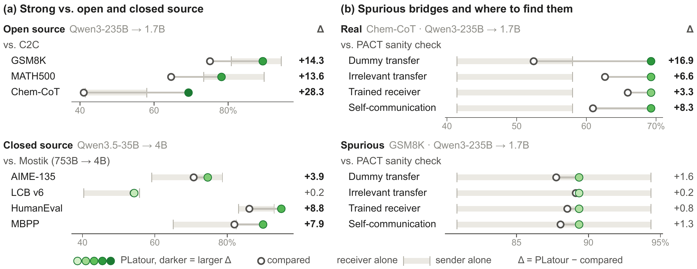
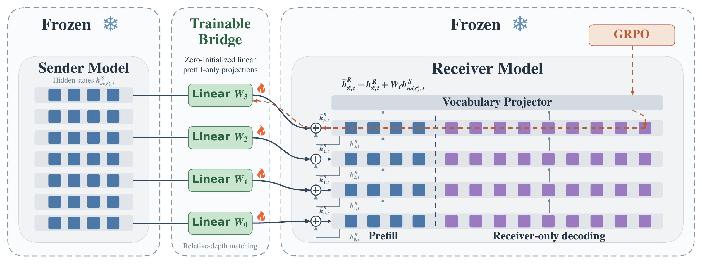

# PLatour

**On the Opportunities and Challenges of Prefill-to-Autoregressive Cross-Model Transfer**

PLatour (**P**refill-only **LAT**ent c**O**mm**U**nication for **R**easoning) is a framework for Prefill-to-Autoregressive Cross-model Transfer (PACT): a larger sender contributes prompt representations during prefill, and a smaller receiver generates the response independently.

> **Release status:** The [paper (PDF)](paper/paper.pdf) is available now; the arXiv version is coming soon. Training code, evaluation/test code, PACT-Check code, and model checkpoints will be released **before November 8, 2026**.

## Overview

- **Lightweight communication.** Zero-initialized linear bridges connect frozen sender and receiver models through hidden-state transfer.
- **Direct reward optimization.** Only the bridges are trained with GRPO, without an alignment or distillation warm-up.
- **Broad applicability.** The framework supports hybrid-attention architectures, generation budgets up to 16K tokens, and sender-to-receiver parameter ratios exceeding 100:1.
- **Controlled evaluation.** PACT-Check examines whether performance gains depend on useful sender information or can be reproduced through receiver-side adaptation.

The paper reports improvements over open-source baselines on generation tasks and over Mostik's reported results on shared mathematics and coding benchmarks with a smaller sender. It also shows that strong benchmark performance alone does not establish useful cross-model information transfer.

## Architecture

During prefill, linear projectors map hidden states from sender layers at corresponding relative depths into the receiver's residual stream. The receiver then performs all autoregressive decoding without further sender involvement. Both model backbones stay frozen; task rewards optimize only the bridge parameters.

## PACT-Check

PACT-Check combines four controls to assess the contribution of sender information:

| Control | What it tests |
| --- | --- |
| Dummy Transfer (DT) | Replace question-dependent sender information with fixed template-level features. |
| Irrelevant Transfer (IT) | Supply sender representations from an unrelated question. |
| Self-Communication (SC) | Train communication modules using the receiver itself as the sender. |
| Trained Receiver (TR) | Adapt the receiver directly with LoRA or full-parameter fine-tuning. |

**PACT-Score** is the accuracy margin over the strongest applicable control. A positive score provides evidence of a benefit from sender information beyond the tested controls.

## Release Roadmap

- [x] Paper
- [ ] arXiv version — coming soon
- [ ] Training code — before November 8, 2026
- [ ] Evaluation/test code — before November 8, 2026
- [ ] PACT-Check code — before November 8, 2026
- [ ] Model checkpoints — before November 8, 2026

Setup and usage instructions will accompany the code release.
